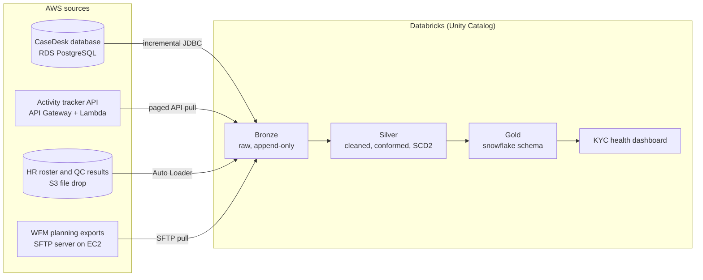

# SupportHub KYC Operations Analytics Platform

An end-to-end data engineering project around a workforce management (WFM) report for a KYC review operation. Four AWS source systems feed a Databricks lakehouse built on the medallion architecture (bronze, silver, gold), and the gold layer powers a **KYC operations health report**: backlog, turnaround against SLA, productivity, capacity, quality, and a burndown calculator for remediation projects.

It is built to look and run like a production setup: infrastructure as code, a daily feed of new data, secrets in a vault, incremental loads, data quality checks and CI.

All data is synthetic. Company, tool and team names are fictional.

## Business case

**SupportHub** runs Know Your Customer (KYC) review operations for banks. About 120 analysts in two sites, **Pune** (India) and **Glasgow** (UK), work cases in a case management tool called **CaseDesk**. Cases land in queues, analysts pick them up, work them, and send them through quality checks until they close.

| Case type | What it is | SLA | Typical handle time |
|---|---|---|---|
| Onboarding (CDD) | Customer due diligence before a new account opens | 2 business days | ~35 min |
| Periodic refresh | Scheduled re-review by risk rating (high risk yearly, medium every 2 years, low every 3 years) | The refresh due date | ~60 min |
| Event-driven (EDD) | Triggered by an alert, adverse media or a risk change; enhanced due diligence | 5 business days | ~2.5 hours |
| Remediation | Project work fixing older files, loaded in large tranches with a deadline | The project deadline | ~90 min |

The workflow has the steps a real KYC desk has: cases wait **pending customer information** (the SLA clock stops), get **escalated** to senior reviewers, are **reassigned** or returned to the queue, and pass a **QC (4-eyes) check**, where failures go back for rework.

Both sites work the same queues, but they have different public holidays and only one observes daylight saving time, so "business days" and "today" depend on where a case is worked.

### The report

The KYC operations health report answers these questions:

1. **Backlog and ageing:** how many cases are open by type, status and age bucket, and is inflow outpacing outflow?
2. **SLA and turnaround:** what share of cases close within SLA, what are the average and P90 turnaround times (with pending-customer time excluded), and which cases are about to breach?
3. **Productivity and handle time:** what is the handle time per case type, how many cases does each analyst close per productive hour, and how is logged-in time split between productive work, meetings, training and breaks?
4. **Capacity:** how does forecast volume compare with actual, how many FTE were required against scheduled and present, and what are adherence and shrinkage?
5. **Quality:** what are the QC pass rate and rework rate, by analyst, team and case type?
6. **Remediation burndown:** given the remaining backlog, staffing and handle time, when will each remediation project finish, and how many FTE are needed to hit its deadline?
7. **Analyst performance:** how does each analyst compare with their team on all of the above?

## Architecture



| # | Source system | AWS service | What it holds | Ingestion pattern |
|---|---|---|---|---|
| 1 | CaseDesk case management (OLTP) | RDS PostgreSQL | Cases, case types, queues, SLA due dates, assignments, the full status history | Incremental JDBC on `updated_at` |
| 2 | Activity tracker | API Gateway + Lambda + DynamoDB | Analyst state changes: productive, meeting, training, break, offline | Paged API pull with `updated_since` |
| 3 | HR and quality drops | S3 | Daily HR roster extract (hires, leavers, team moves), QC results | Auto Loader |
| 4 | WFM planning tool | SFTP on EC2 | Volume forecasts by case type, analyst schedules, remediation project plans | SFTP pull |

## Data generator

`data_generator/` simulates the operation day by day. Each day new cases arrive, everyone rostered builds their actual day from the WFM plan (late logins, overrunning breaks, sick days), and the workforce is run in time order: whoever is free next picks the most urgent case they are skilled for and works it for a realistic handle time across their productive time. Cases then go pending, get escalated, pass or fail QC, are reassigned when their owner is away, and close. Every source is written from that one simulation, so case events, activity segments, QC results, rosters and schedules agree the way they would in a real operation.

```bash
make generate          # 90 days, about 30 seconds
make generate-small    # 14 days at 10% volume, a few seconds
```

A 150-day run produces about 61,000 cases, 360,000 case events and 2,700 closures a week. Highlights the report should find: a backlog wave after every monthly periodic-refresh release, onboarding cases breaching over weekends, remediation project REM-01 finishing three weeks after its deadline, and REM-02 at risk because REM-01 took its capacity.

The output mirrors the four source systems; the schema of every feed is in [`contracts/`](contracts/), and the CaseDesk DDL is in [`data_generator/sources/casedesk_schema.sql`](data_generator/sources/casedesk_schema.sql).

| Folder | Source system | Contents |
|---|---|---|
| `output/casedesk/` | RDS PostgreSQL | `case_types`, `queues`, `users`, `remediation_projects`, `cases`, `case_events` |
| `output/activity_api/` | Activity tracker API | `segments.jsonl`: one document per activity segment |
| `output/s3/hr/roster/` | S3 file drop | Daily full roster snapshot |
| `output/s3/qc/results/` | S3 file drop | Daily QC results export |
| `output/sftp/wfm/` | SFTP | Weekly forecasts, weekly schedules (with re-published versions), remediation plans |

### Data problems built in on purpose

| Source | Problem | What the pipeline must do |
|---|---|---|
| CaseDesk | `cases` is updated in place; the status history is a separate event table | Rebuild each case's lifecycle and time in status from events |
| CaseDesk | About 2% of events are recorded hours late; about 0.5% are written twice | Deduplicate on `event_id`; order by `event_ts`, load by `recorded_at` |
| CaseDesk | `due_at` counts calendar days and ignores holidays and pauses | Build a business-day calendar per site and an SLA clock that stops while pending customer information |
| Activity tracker | Analysts are identified by network login, sometimes in upper case | Normalise and map logins to employee ids through the HR roster |
| Activity tracker | Some segments never end; some overlap the next one | Cap open segments at the end of the shift; trim overlaps |
| HR roster | Full daily snapshots; team moves, leavers and new hires | Build SCD Type 2 history from snapshots |
| QC results | Sampled, not every case; about 5% land a day late | Join on case and attempt; allow late arrivals |
| WFM schedules | Local times without an offset; re-published versions | Convert with the site's time zone; keep the latest version and the history |
| WFM forecasts | A new version every week | Compare actuals with the version current at the time |
| All | Two time zones, one with DST; different holidays | Store UTC plus site-local dates |

## AWS sources

`infra/terraform/` creates SupportHub's sources in `us-east-1`. To keep the cost to cents a month, two of them live on servers the owner's earlier project, RetailPulse, already runs in the same account; its Terraform owns those servers and their daily 06:00 to 08:00 UTC run window, and SupportHub only adds to them.

| Source | AWS resources | Notes |
|---|---|---|
| CaseDesk | Database `supporthub`, schema `casedesk` on the shared RDS PostgreSQL 17 instance | Owner login for the simulator, read-only login for the pipelines (default privileges on new tables); TLS required; other logins on the instance cannot connect |
| Activity tracker | DynamoDB (on-demand) + Lambda (Python, arm64) + API Gateway REST API | API key and usage plan; a GSI on the UTC day of `updated_at` serves `updated_since` pulls |
| HR and QC drops | S3 bucket `sources`, versioned, encrypted, TLS-only | A separate `simulator` bucket holds the pre-generated year; the pipelines cannot read it |
| WFM exports | User `supporthub` on the shared OpenSSH server | Chrooted and key-only; created on the instance through SSM Run Command |

Connection details and secrets are in SSM Parameter Store under `/supporthub/dev/`. Two IAM users exist for Databricks, `simulator` (writes) and `pipelines` (read-only, an allow-list of parameters); their keys go straight into a Databricks secret scope with `infra/scripts/store-aws-key-in-databricks.ps1`.

```bash
cp infra/terraform/envs/dev/backend.hcl.example infra/terraform/envs/dev/backend.hcl   # fill in the bucket
make sources-up                      # the shared RDS instance must be running for plan and apply
make infra-init infra-plan infra-apply
make infra-destroy                   # removes SupportHub's sources; RetailPulse's servers stay
```

## Daily source simulator

The sources behave like live systems: they hold history from 2026-06-30 and receive the next day's changes every morning.

1. `python -m data_generator.daily` simulates the fixed one-year calendar once and writes one folder per day with only that day's changes: CaseDesk upserts, activity segments, and the files that arrive. Tests prove that replaying the days in order rebuilds every source exactly.
2. The folders sit in the private `simulator` bucket (280 MB for the year), which the pipelines cannot read.
3. `python -m data_generator.publish` applies every day not yet published, up to yesterday: CaseDesk upserts (one transaction per day), DynamoDB puts, S3 copies, and SFTP uploads written as `.part` and renamed. Every write replaces by key, so a rerun is harmless, and missed days are caught up on the next run.
4. The Databricks job `supporthub-source-simulator` runs it at 06:15 UTC on serverless, inside the window when the shared servers are up. It is defined in `databricks.yml` and deployed with `databricks bundle deploy`.

On 2026-11-11 the history (134 days) was published in 4 minutes and checked source by source: 57,389 cases, 318,749 case events, 129 users, 99,442 activity segments, 247 S3 files and 63 SFTP files.

## Reading the sources

What the bronze layer works with. Connection details are in SSM Parameter Store under `/supporthub/dev/`; Databricks reads them with the `pipelines` IAM user, whose key is in the `supporthub-dev` secret scope (`aws_access_key_id`, `aws_secret_access_key`). `databricks/notebooks/01_source_connectivity_test.py` shows each connection.

| Source | Where | Login | New data appears |
|---|---|---|---|
| CaseDesk | `postgres/host`, database `supporthub`, schema `casedesk`, TLS required | `postgres/reader_username` / `postgres/reader_password` (read-only) | `cases` updated in place (pull on `updated_at`); `case_events` appended (pull on `event_row_id` or `recorded_at`) |
| Activity tracker | `activity_api/url`, header `x-api-key: <activity_api/api_key>` | API key | `GET ?updated_since=<ISO>&limit=<=1000`, then follow `next_page_token`; no `updated_since` pages through everything |
| HR and QC | bucket `s3/sources_bucket`: `hr/roster/extract_date=YYYY-MM-DD/`, `qc/results/date=YYYY-MM-DD/` | IAM `pipelines` user | One roster snapshot and one QC export a day; some QC results land a day late |
| WFM exports | host from the parameter named in `sftp/host_parameter` (the shared server's IP changes when it restarts), user `sftp/username`, key `sftp/private_key` | ED25519 key | `wfm/forecasts/` on Mondays, `wfm/schedules/` on Thursdays (v2 on Mondays), `wfm/remediation/`; skip `*.part`; move pulled files to `archive/` |

The shared RDS instance and SFTP server run 06:00 to 08:00 UTC. Outside that window, start them with `make sources-up` (or `rds:StartDBInstance` / `ec2:StartInstances`, which the `pipelines` user may call).

## Progress

| Milestone | What it delivers | Status |
|---|---|---|
| M0 Scaffold | Repo layout, README, project plan, CI skeleton | Done |
| M1 Data generator | Seeded simulation of the KYC operation and every source feed, data contracts, tests | Done |
| M2 AWS sources | Terraform for the four source systems, secrets, IAM | Done |
| M3 Load the sources | History since 2026-06-30 in every source, then a daily simulator job in Databricks | Done |
| M4 Databricks foundation | Catalogs, schemas, secret scope | Planned |
| M5 Bronze | One ingestion job per source, with audit columns and watermarks | Planned |
| M6 Silver | Case lifecycle, business-day SLA clock, analyst ID mapping, SCD2, quarantine | Planned |
| M7 Gold | Snowflake model and the measures behind the report | Planned |
| M8 Orchestration and ops | One end-to-end workflow, alerts, audit table, CI deploys | Planned |
| M9 Showcase | KYC health dashboard, burndown calculator, screenshots, write-up | Planned |

M0 to M3 build the sources and their daily feed; M4 to M9 (the lakehouse and the report) are built by the project owner.

## Getting started

Requirements: Python 3.11 or newer, Terraform 1.10 or newer (from M2), the Databricks CLI (from M3), and an AWS account.

```bash
python -m venv .venv && source .venv/bin/activate
pip install -e ".[dev]"
make test
```

AWS and Databricks credentials are never stored in this repository. Configure them locally with `aws configure` and `databricks auth login`.

See [docs/project-plan.md](docs/project-plan.md) for the full plan and [docs/HANDOFF.md](docs/HANDOFF.md) for the current state and next steps.
