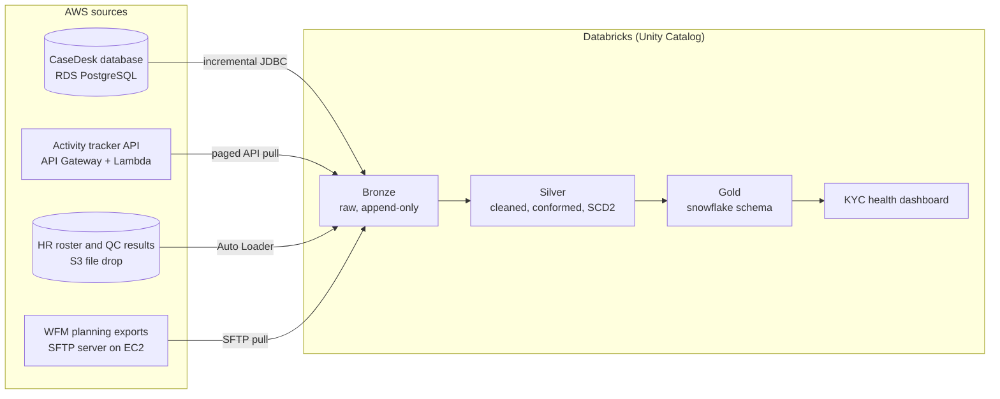

# SupportHub KYC Operations Analytics Platform

An end-to-end data engineering project around a workforce management (WFM) report for a KYC review operation. Four AWS source systems feed a Databricks lakehouse built on the medallion architecture (bronze, silver, gold), and the gold layer powers a **KYC operations health report**: backlog, turnaround against SLA, productivity, capacity, quality, and a burndown calculator for remediation projects.

It is built to look and run like a production setup: infrastructure as code, a daily feed of new data, secrets in a vault, incremental loads, data quality checks and CI.

All data is synthetic. Company, tool and team names are fictional.

## Business case

**SupportHub** runs Know Your Customer (KYC) review operations for banks. About 120 analysts in two sites, **Pune** (India) and **Glasgow** (UK), work cases in a case management tool called **CaseDesk**. Cases land in queues, analysts pick them up, work them, and send them through quality checks until they close.

| Case type | What it is | SLA | Typical handle time |
|---|---|---|---|
| Onboarding (CDD) | Customer due diligence before a new account opens | 2 business days | ~40 min |
| Periodic refresh | Scheduled re-review by risk rating (high risk yearly, medium every 2 years, low every 3 years) | The refresh due date | ~70 min |
| Event-driven (EDD) | Triggered by an alert, adverse media or a risk change; enhanced due diligence | 5 business days | ~3 hours |
| Remediation | Project work fixing older files, with planned volumes and a deadline | The project deadline | ~75 min |

The workflow has the steps a real KYC desk has: cases wait **pending customer information** (the SLA clock stops), get **escalated** to senior reviewers, are **reassigned** or returned to the queue, and pass a **QC (4-eyes) check**, where failures go back for rework.

Each team works across both sites, which use different public holidays and only one of which observes daylight saving time, so "business days" and "today" depend on where a case is worked.

### The report

The KYC operations health report answers these questions:

1. **Backlog and ageing:** how many cases are open by type, status and age bucket, and is inflow outpacing outflow?
2. **SLA and turnaround:** what share of cases close within SLA, what are the average and P90 turnaround times (with pending-customer time excluded), and which cases are about to breach?
3. **Productivity and handle time:** what is the handle time per case type, how many cases does each analyst close per productive hour, and how is logged-in time split between productive work, meetings, training and breaks?
4. **Capacity:** how does forecast volume compare with actual, how many FTE were required against scheduled and present, and what are adherence and shrinkage?
5. **Quality:** what are the QC pass rate and rework rate, by analyst, team and case type?
6. **Remediation burndown:** given the remaining backlog, staffing and handle time, when will each remediation project finish, and how many FTE are needed to hit its deadline?
7. **Analyst performance:** how does each analyst compare with their team on all of the above?

## Architecture



| # | Source system | AWS service | What it holds | Ingestion pattern |
|---|---|---|---|---|
| 1 | CaseDesk case management (OLTP) | RDS PostgreSQL | Cases, case types, queues, SLA due dates, assignments, the full status history | Incremental JDBC on `updated_at` |
| 2 | Activity tracker | API Gateway + Lambda + DynamoDB | Analyst state changes: productive, meeting, training, break, offline | Paged API pull with `updated_since` |
| 3 | HR and quality drops | S3 | Daily HR roster extract (hires, leavers, team moves), QC results | Auto Loader |
| 4 | WFM planning tool | SFTP on EC2 | Volume forecasts by case type, analyst schedules, remediation project plans | SFTP pull |

## Progress

| Milestone | What it delivers | Status |
|---|---|---|
| M0 Scaffold | Repo layout, README, project plan, CI skeleton | Done |
| M1 Data generator | Seeded simulation of the KYC operation and every source feed, data contracts, tests | Planned |
| M2 AWS sources | Terraform for the four source systems, secrets, IAM, budget alert | Planned |
| M3 Load the sources | History in every source, then a daily simulator job | Planned |
| M4 Databricks foundation | Catalogs, schemas, secret scope | Planned |
| M5 Bronze | One ingestion job per source, with audit columns and watermarks | Planned |
| M6 Silver | Case lifecycle, business-day SLA clock, analyst ID mapping, SCD2, quarantine | Planned |
| M7 Gold | Snowflake model and the measures behind the report | Planned |
| M8 Orchestration and ops | One end-to-end workflow, alerts, audit table, CI deploys | Planned |
| M9 Showcase | KYC health dashboard, burndown calculator, screenshots, write-up | Planned |

M0 to M3 build the sources and their daily feed; M4 to M9 (the lakehouse and the report) are built by the project owner.

## Getting started

Requirements: Python 3.11 or newer, Terraform 1.10 or newer (from M2), the Databricks CLI (from M3), and an AWS account.

```bash
python -m venv .venv && source .venv/bin/activate
pip install -e ".[dev]"
make test
```

AWS and Databricks credentials are never stored in this repository. Configure them locally with `aws configure` and `databricks auth login`.

See [docs/project-plan.md](docs/project-plan.md) for the full plan and [docs/HANDOFF.md](docs/HANDOFF.md) for the current state and next steps.
